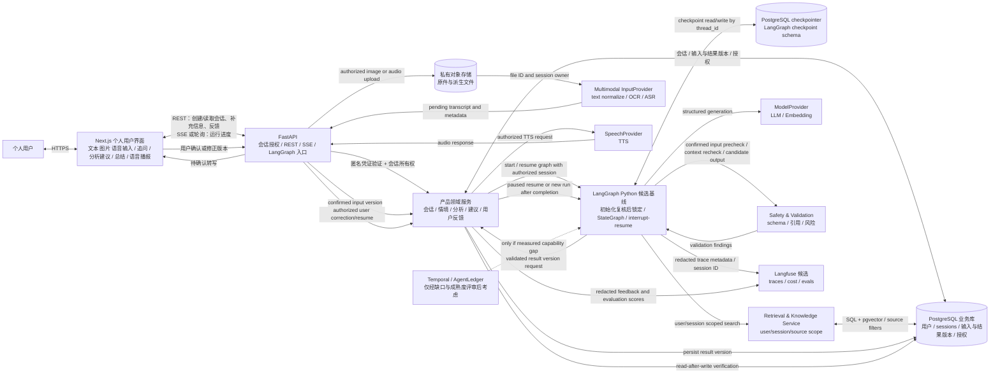

# 工程设计说明：情感困境分析与复盘 Agent（首轮验证方案）

| 字段 | 内容 |
|---|---|
| 文档编号 | ENG-001 |
| 版本 | 0.7 |
| 状态 | 首轮个人用户验证工程基线；与首轮验证 PRD 配套，产品价值仍待验证 |
| 日期 | 2026-10-16 |
| 关联文档 | [C 端产品体验 PRD](../C端产品设计/PRD-情感沟通复盘助手-C端MVP.md)、[阶段任务与验收标准](阶段任务与验收标准.md)、[研究报告一](../市场调研/最终报告.pdf)、[研究报告二](../市场调研/最终报告-2.pdf) |
| 负责人 | 项目发起人 |

## 1. 决策摘要与产品边界

本工程方案支持首轮测试 **面向个人的情感困境分析与复盘 Agent**。首轮从成年学生/开发者群体招募测试样本，以获取早期真实使用数据；这只是首轮样本策略，不定义长期目标客群，也不意味着产品是面向企业采购的 B2B 服务。此前把专业情感内容创作者工作台写成当前产品方向，是方向误判，已由当前 PRD 和本次修订取代。

现有[首轮验证 PRD](PRD-情感困境分析与复盘Agent-C端首轮验证.md) 定义当前核心任务和测试策略；用户长期客群、产品价值和付费假设仍待真实数据验证。[C 端产品 PRD](../C端产品设计/PRD-情感沟通复盘助手-C端MVP.md) 与本轮方向一致，后续应保持对核心分析能力和交互原则的同步。

### 首个候选任务

用户自然讲述情感经历、矛盾和问题后，Agent 理解上下文，分析互动与用户自身可调整之处，必要时少量澄清，并提供有依据、可执行的处理建议。LLM 是综合分析与决策核心；对话自然引导，不采用固定长问卷或诊疗式盘问。

## 2. 核心技术决策

1. **CLI 优先验证，再开发 Web。** 先通过 Typer CLI 跑通最小情感分析闭环，验证 LangGraph、模型接口、状态恢复、分析契约和安全检查是否可用；架构通过阶段验收后才开发 Web/API。CLI 与 Web 共用同一 Python 领域核心。
2. **直接采用成熟开源 Harness。** 首轮采用 LangGraph Python 管理情感复盘流程状态、分支、有限澄清、持久化与人工反馈恢复；不从零自建 Harness 引擎。
3. **先实现单一可追踪工作流，不做 Agent 群。** 上下文理解、必要澄清、复盘分析、优化建议和安全检查分别是有契约的步骤；必要时同一模型多次调用，是否需要独立审稿模型由评测决定。
4. **Python 承担领域核心、CLI、API 和 Agent；TypeScript 仅用于网页。** Typer CLI 先调用领域核心；FastAPI 与 Next.js 在后续阶段复用同一业务服务和 Pydantic 契约。
5. **CLI 结构化事件是 Web 后端日志的基线。** CLI 输出人可读结果和脱敏 JSONL 运行事件；Web API 沿用同一事件字段、错误码和脱敏策略，使 CLI 与 Web 请求可用同一方式定位问题和回放合成案例。
6. **按用户/会话隔离材料。** 经审阅的公共参考资料只读共享；个人会话材料仅供该用户使用，不进入共享记忆或跨用户检索。
7. **OpenClaw 不作为产品运行时或检索底座。** 它可作内部原型对照和设计参考；不得承载外部测试者真实情感材料，也不作为个人情感材料存储或分析系统。
8. **LangGraph 作为单一工作流 Harness。** 不叠加另一套 Agent 主循环或执行状态系统。业务会话与分析版本保存在本项目数据库；LangGraph checkpoint 只用于流程恢复，不替代业务数据。Temporal 仅在实际运行证明 LangGraph + 现有服务无法满足长时分布式执行后再评估。
9. **狗头军师（github)只借鉴领域方法。** 参考其事实/推测/未知区分、证据分级、按需取用知识、同意和删除设计；不直接复用其 C 端恋爱军师流程或用户记忆模型。代码 MIT 许可不自动代表仓库中所有知识资料可再分发，知识内容需逐条核对来源和授权。

## 3. 建议技术栈

| 层 | 选型 | 职责 |
|---|---|---|
| Web | Next.js + TypeScript | 文本、图片、语音输入；分析建议、语音播报、反馈与删除 |
| API | FastAPI + Python | 多模态输入编排、Agent 工作流、检索、用户/会话权限 |
| CLI | Typer + Python | 首轮核心闭环验证、合成案例回放、结构化运行事件和调试 |
| 契约 | Pydantic 模型与 JSON Schema 输出 | 校验输入、情境理解、分析建议和安全检查结果 |
| 数据库 | 阶段 1 SQLite；阶段 2 PostgreSQL | 用户、会话、结果版本、授权和反馈；业务数据是用户可见结果的权威来源 |
| 向量检索（可选） | pgvector | 仅对经审阅的参考资料做语义检索 |
| 关键词检索 | Python 中文分词 + PostgreSQL 全文检索 | 精确术语、标题、来源名称等匹配；需评测分词质量 |
| ORM/迁移 | SQLAlchemy + Alembic | 数据访问与可重复 schema 迁移 |
| 多模态输入 | 独立 InputProvider 接口 | 文本规范化、图片 OCR、音频 ASR；非文本先转成可确认的文本与元数据 |
| 语音输出 | 独立 SpeechProvider 接口 | 将已通过安全与质量检查的分析/建议按用户操作转成 TTS 音频 |
| 模型调用 | 服务端 ModelProvider 适配层 | 统一结构化调用、超时、模型版本和供应商切换 |
| Agent Harness / 工作流 | LangGraph Python `1.2.15`（既有候选基线，初始化时复核） | 对话/分析状态图、有限分支、checkpoint 与 interrupt/resume；流程状态不取代业务会话表 |
| PostgreSQL Checkpointer | LangGraph 官方 PostgreSQL checkpointer 兼容版本（初始化时锁定） | 保存图 checkpoint，支持恢复；与用户数据/分析版本隔离并设置保留期限 |
| 观测与评估 | 优先评估 Langfuse；OpenTelemetry 作为可移植埋点接口候选 | LLM trace、成本、数据集评估、提示/模型对比；原始敏感输入默认不采集 |
| Durable Workflow | Temporal 暂不默认引入 | 只有真实任务证明需要跨服务长时间等待/分布式协调且 LangGraph 不能满足时再评估 |

LangGraph `1.2.15` 为既有文档记录的候选基线；本次一致性修订未重新核验上游发布或依赖兼容性，不据此宣称其为当前最新版。正式初始化时复核版本可用性、Python/模型集成及 checkpointer 兼容性，再锁定完整解析依赖。checkpointer 用于跨调用恢复；是否自托管 LangGraph Server 不作为首轮前提。API 密钥只在服务端；模型、OCR、ASR、TTS、文件处理及可观测性服务接入前记录数据传输、留存、训练和删除政策。会话和私有材料必须按用户/会话授权过滤。

## 4. 目录结构

```text
emotional-agent/
├── apps/
│   ├── web/                         # Next.js 个人用户分析体验
│   └── api/                         # FastAPI 应用与 HTTP 层
├── packages-py/                     # Python 项目（uv 或其他单一 Python 管理方案）
│   ├── agent_core/                  # 个人情感分析领域步骤与数据契约
│   ├── harness/                     # LangGraph 图定义、节点、路由与配置
│   │   ├── graphs/                  # 情境分析与复盘图、编译入口
│   │   ├── nodes/                   # 理解、澄清、分析、建议、安全检查
│   │   └── persistence/             # 本地/PG checkpointer 与保留/清理
│   ├── workflows/                   # 产品领域逻辑；不重复实现 Harness 状态机
│   │   └── relationship_review/      # 情境理解、复盘分析、建议与安全检查
│   ├── retrieval/                   # 分片、过滤、关键词/向量检索、来源回传
│   ├── schemas/                     # Session、Input、Evidence、Analysis、Safety、Consent
│   ├── safety/                      # 内容风险规则、拒绝/提示、发布前审校
│   ├── providers/                   # LLM、Embedding、OCR、ASR、TTS、文件解析适配器
│   ├── storage/                     # SQLAlchemy 模型、仓储、文件存储与删除
│   ├── observability/               # Langfuse/OTel adapter，按配置脱敏
│   └── cli/                         # Typer 命令
├── evals/
│   ├── cases/                       # 合成/获准且脱敏的内容任务案例
│   ├── rubrics/                     # 来源忠实度、建议质量、风险与追问体验标准
│   └── results/                     # 不含未授权原文的评测结果
├── doc/                             # 按当前开发归档、C端产品、市场调研分类
│   ├── C端开发/
│   ├── C端产品设计/
│   └── 市场调研/
├── scripts/                         # 导入、去重、重建索引、删除等受控脚本
├── .env.example
├── .gitignore                       # 忽略密钥、数据库、上传件、敏感评测输入
└── README.md
```

`doc/` 是当前唯一文档源；不要另行维护重复的 `docs/` 副本。

## 5. Agent / Harness 设计

### 5.0.1 工程可靠性原则

按个人情感分析产品的实际风险和阶段逐步落地以下通用原则：

| 可借鉴原则 | 本项目中的落点 | 明确边界 |
|---|---|---|
| 运行成功不等于业务结果正确 | 分析结果通过 Pydantic/schema、安全与质量校验，并成功保存、读回后，才报告已完成 | 模型、LangGraph 节点或 Trace 的成功状态不能单独证明分析质量或持久化成功 |
| 分离流程状态、业务数据和观测记录 | LangGraph checkpoint 仅服务流程恢复；业务数据库是会话和分析版本的权威；Trace 用于诊断 | Trace 不是业务事实或正确性证据；checkpoint 不是用户可见结果的权威来源 |
| 评估使用独立标准，未知不计为成功 | 使用合成/获准案例、固定条件和人工 rubric；区分通过、未通过与无法判断 | 不以 Agent 自评、最终措辞或调用链成功代替质量评测 |
| 治理复杂度由真实风险驱动 | 当前首轮是分析与建议流程，先做会话授权、数据隔离、安全检查和结果校验 | 当前不引入面向外部副作用的审批台账、租约或 fencing 等复杂治理；若未来出现真实外部操作，再单独评估需求 |

以上为设计原则，不代表已实现或已验证。首轮阶段优先通过 CLI 验证流程、分析契约和结果读回，再按实际风险增加治理能力。

### 5.1 Harness 选型、集成与版本策略

**决策：本项目首轮采用 LangGraph Python 开源库作为唯一工作流 Harness。**它提供状态图、分支/循环、checkpoint 持久化和 interrupt/resume，可承载情感复盘中的理解、有限澄清、分析、建议与安全检查流程；项目不自行实现 Harness 引擎，也不并行引入另一套 Agent 主循环。

- **版本基线：**保留既有 `langgraph==1.2.15` 候选记录；阶段 0/1 初始化时复核发布真实性、可用性、Python/模型 Provider/checkpointer 兼容性及完整传递依赖。若需变更，记录原因、验收结果并同步阶段计划；本次不作上游最新版本结论。
- **运行边界：**LangGraph 作为 Python 依赖在本项目 worker/API 运行环境执行；上游代码不复制进仓库。`packages-py/harness/` 只保存本项目的图、节点、状态 schema、运行入口及 checkpoint 配置。
- **状态分工：**LangGraph checkpoint 保存恢复流程所需的运行状态；业务数据库保存用户会话、用户输入版本、分析/总结版本、授权和反馈，是用户可见业务结果的权威来源。两者采用独立 schema/表与明确保留/删除策略。
- **隐私边界：**checkpoint 中只保存恢复所需的最少数据，优先保存会话/版本 ID 而不是完整聊天原文；若图运行必须携带敏感文本，则将 checkpoint 视为敏感用户数据，实施访问控制、留存和删除。
- **业务契约：**所有输入输出使用项目 Pydantic schema；工具和检索由服务端授权，不能把 prompt 或图状态当作权限控制。每个会话使用不可猜测的 thread ID，API 每次读取/恢复前重新核验该用户对会话的权限。
- **流式与恢复：**Web 只访问本项目 FastAPI；API 创建分析会话/运行并返回业务 session ID，后端运行 LangGraph，进度通过本项目 SSE/轮询传回。用户补充/纠正后，API 校验所有权；暂停中的澄清恢复原运行，已完成后的纠正创建关联同一 session 的新运行。LangGraph Server/托管服务不是首轮必需依赖。
- **观测评估：**优先评估 Langfuse 采集模型调用、步骤耗时、token/成本和数据集评测；以业务 session ID 关联 trace，默认不记录原始情感经历、聊天记录或完整提示词。Langfuse Trace 不能代替业务数据是否保存成功的验证。
- **升级策略：**不自动追随上游最新版。升级前检查 release notes、接口/状态兼容、依赖安全与许可证；在隔离变更中验证 checkpoint 恢复、interrupt/resume、隐私删除、代表性评测与成本/延迟，并保留可回滚 lockfile/制品。
- **候选组件边界：**Temporal 只在长时间等待/跨服务恢复需求超出 LangGraph 与当前服务能力时再评估；OpenTelemetry 用于未来跨服务 trace 标准化；AgentLedger 可作可靠性设计对照，但需先审核实现成熟度，不与 LangGraph 同时叠加两套状态恢复系统。

### 5.2 工作流

```text
用户通过文本、图片或语音描述
  → 输入校验；图片/音频先由 provider 转为待确认文本
  → 用户检查并修正识别文本；无法确认时回退为手动输入
  → 前置安全筛查（规则与可测试的风险分类）
  → 提取用户目标、关键事件、感受与已知背景
  → 情境理解后的二次安全筛查
  → LLM 综合分析互动模式与用户可调整之处
  → 形成当前材料支持的初步分析；必要时附一个决定性澄清问题
  → 对初步分析、问题或安全回应执行输出检查 → 保存并回读 → 交付
  → 需要澄清时暂停等待；用户补充经确认、重新筛查后更新分析，跳过则收束
  → 最终分析通过检查、保存回读后才标记完成
  → 用户补充/纠正后更新分析，或生成可回看的复盘总结
  → 用户主动选择时，TTS 播报已校验的总结或建议
```

允许对不完整输入做有限澄清和对输出做一次质量修订；不能无限自我反思或为了延长会话而追问。每次用户补充或修正都重新执行风险筛查和版本校验。关键信息不足时说明不确定性，先给出当前可支持的分析。OCR/ASR 的转写是待用户确认的输入，不当作完整事实；TTS 仅播报当前结果版本且已经过安全与质量检查的内容。用户自行决定是否采纳建议。

### 5.3 LangGraph 图与本项目接口

LangGraph 负责流程控制；业务逻辑仍通过本项目的 service/provider 接口完成。节点不得绕过服务端授权直连用户数据，也不能把模型输出未经校验地当成已保存结果。

| 节点 | 输入 | 调用接口/动作 | 输出与下一步 |
|---|---|---|---|
| `ingest_multimodal`（应用层入口） | 文本、图片或音频及输入元数据 | `InputProvider` 完成文本规范化、OCR 或 ASR | 待确认文本与输入来源 → 用户确认 → 图入口 pre_safety_gate |
| `pre_safety_gate` | 已确认的输入版本 | 本地规则与可测试的风险分类 | 高风险或风险不确定 → 安全回应；其余 → 情境理解 |
| `understand_context` | 已确认的输入版本、当前目标、会话摘要 | schema 校验与 LLM 情境理解 | 事件/感受/用户解释/用户目标结构 → 二次风险筛查 |
| `safety_gate` | 理解结果和风险信号 | 本地安全规则与安全回应策略 | 常规情境 → analyze_and_advise；高风险 → 安全回应；风险不确定 → 保守安全回应/受控复核，不继续普通建议 |
| `clarify_if_needed` | 缺失背景、当前判断与建议 | 判断缺失信息是否会实质改变建议；为候选输出附可跳过的问题或收束标记 | → quality_review；不在初步结果交付前 interrupt |
| `analyze_and_advise` | 经校验的会话上下文、获准参考资料 | `ModelProvider.generate_structured()` | 多种可能解释、依据、不确定性、用户可调整点、可选建议 → clarify_if_needed |
| `safe_response` | 风险类型与最少必要上下文 | 生成安全导向回应，停止普通建议 | → quality_review；不得绕过输出校验 |
| `quality_review` | 候选分析、澄清问题或安全回应 | schema、事实来源、一致性、风险与建议可执行性检查 | 通过 → 保存版本；最多修订一次；仍失败 → 受控固定错误提示，不交付候选正文 |
| `persist_result` | 校验通过的结果对象 | `AnalysisRepository.save_version()` | 返回确实持久化的 result version ID |
| `finalize` | 已保存版本 ID 与校验记录 | `AnalysisRepository.get_version()` 回读验证 | 返回已校验初步结果后 interrupt 等待澄清，或标记本 run 完成；补充经授权、确认后回到 pre_safety_gate |
| `synthesize_speech` | 用户主动请求的已校验总结/建议 | `SpeechProvider.synthesize()` | 带版本与保留策略的 TTS 音频；失败不影响文本结果 |

输入接入与确认由应用层编排，表中 ingest_multimodal 是该入口步骤，不在图内重复调用 OCR/ASR。仅等待澄清的运行使用 interrupt/resume；已完成后的纠正创建新输入版本和新 run，关联同一业务 session，重新筛查和分析，不对已结束运行盲目 resume。Web 用户输入先经 FastAPI 校验会话所有权。业务数据库回读确认结果存在后才向用户报告已完成。评测 trace 记录 session/thread 关联 ID，但默认不收集原始输入、原始音频或原始图片。

保存、读回与等待节点分别持久化进度；进入 interrupt 前先提交初步结果和 waiting_clarification 状态，由 CLI 显示或 Web 结果接口读取。恢复时可能重执行节点，保存与澄清预算扣减须按 run/轮次幂等，不能重复创建结果、重复提问或重复计费。用户主动跳过时用已保存输入收束，不将“跳过”当作新的事实材料；权限、删除状态和当前版本在恢复前重验。

澄清的首版配置为每轮最多一个决定性问题、每次分析请求最多两次，阶段 0 纳入 rubric，后续变更保留评测依据。用户可跳过；系统不能通过新建 run 重置自动追问预算。跳过或达到上限后仅输出现有材料支持的有限建议，安全性仍不明确时走安全回应。初步分析与澄清问题必须先通过 quality_review、保存并回读，用户才能在回答前看到当前可支持的帮助；等待时运行状态为 waiting_clarification，不能报 completed。安全风险不允许分析时只给安全回应。SSE 只传进度，已校验正文通过结果接口获取。规则、风险分类模型与人工复核职责分别记录，不能仅依赖关键词或生成模型自评；不承诺实时人工值守。

### 5.4 OpenClaw 与 Goutoujunshi 的使用边界

- OpenClaw 可用于内部快速比较 skill/提示效果，或者参考个人记忆搜索配置；不得直接承载 外部测试者的真实情感材料，也不作为个人情感材料存储或分析系统。
- Goutoujunshi 可为情感分析中的事实/感受/推测/未知边界、安全红线和参考资料分类提供设计输入；不能视为情感分析建议质量、用户价值或付费的证据。
- 若要复用任一仓库的代码/内容，记录 commit、许可和被复用文件；知识文档及第三方引用单独做来源和权利检查。

## 6. 知识库和 RAG 设计

### 6.1 两类知识域

1. **经审阅的情感/心理学参考库（可选、只读）：**只纳入可核验、适用范围明确的参考内容，用于支持分析，不用于把心理学概念贴成用户或第三方诊断。
2. **单次会话材料（默认临时）：**用户描述、可选聊天片段、Agent 分析和建议仅用于本次服务；默认不进入长期记忆、共享向量库或模型训练。

只有当评测证明长期记忆或检索确实提升用户价值且获得清晰授权后，才另行设计该能力。不同用户之间不共享输入、向量、提示上下文或反馈。

### 6.2 文档处理与分片

- 如首轮评测确认需要参考资料检索，保存原始文档记录和解析版本；解析后的章节、段落、分片保留 `source_id`、标题路径、页码/段落位置、内容哈希、许可状态和有效日期。用户输入和会话材料不写入共享知识库。
- 长文按标题、章节和自然段切分；长度阈值、重叠窗口和 embedding 模型通过检索评测确定，不使用未经验证的固定参数。
- 短篇参考案例保留完整语境，不为向量化强行切碎。
- 检索只访问经审阅的只读参考资料，并按允许的 `source_id`、来源类型和任务范围过滤；不得检索其他用户会话。引用返回原文片段及出处。
- 默认先精确向量检索；数据量和延迟证明有需要后再启用近似向量索引或独立搜索服务。
- 删除源文档时，同步删除分片、embedding、解析缓存和关联分析结果引用；执行删除需可审计。

### 6.3 知识写入与来源审阅

知识导入流程：解析 → 提取标题/标签/候选 claim → 用户或项目管理员审核 → 确认许可/敏感级别 → 分片/索引 → 抽样检索检查。Agent 不可自行把生成内容或用户案例写成共享事实。来源冲突需并存并标记，不得让新材料静默覆盖旧结论。

## 7. 数据契约草案

```py
from datetime import datetime
from typing import Literal
from uuid import UUID
from pydantic import BaseModel

class InputVersion(BaseModel):
    input_version_id: UUID
    session_id: UUID
    modality: Literal["text", "image", "audio"]
    confirmed_text: str | None
    confirmation: Literal["pending", "confirmed", "corrected"]
    source_asset_ids: list[UUID]

class AnalysisSession(BaseModel):
    session_id: UUID
    subject_id: UUID  # 匿名主体或已认证用户；不等同于注册账号
    input_version_id: UUID
    user_goal: str | None
    allowed_source_ids: list[UUID]

class RetrievedSource(BaseModel):
    source_id: UUID
    source_version_id: UUID
    source_type: str
    title: str
    excerpt: str
    locator: str | None       # page/section/paragraph
    evidence_tier: str | None
    source_url: str | None

class EvidenceRef(BaseModel):
    evidence_id: UUID
    source_kind: Literal["user_input", "reviewed_reference"]
    input_version_id: UUID | None
    source_id: UUID | None
    source_version_id: UUID | None
    span_start: int
    span_end: int
    quoted_text: str

class Claim(BaseModel):
    claim_id: UUID
    kind: Literal["event", "feeling", "user_interpretation", "hypothesis", "unknown"]
    text: str
    evidence_ids: list[UUID]

class Suggestion(BaseModel):
    suggestion_id: UUID
    text: str
    supporting_claim_ids: list[UUID]
    evidence_ids: list[UUID]
    applicability: str
    limitations: str

class ImprovementConsent(BaseModel):
    consent_id: UUID
    subject_id: UUID
    session_id: UUID
    purpose: Literal["product_improvement"]
    notice_version: str
    status: Literal["denied", "granted", "revoked"] = "denied"
    data_version_ids: list[UUID]
    updated_at: datetime

class AnalysisResult(BaseModel):
    session_id: UUID
    run_id: UUID
    result_version_id: UUID
    input_version_id: UUID
    kind: Literal["initial", "final", "safety"]
    claims: list[Claim]
    evidence_refs: list[EvidenceRef]
    uncertainties: list[str]
    user_adjustments: list[str]
    suggestions: list[Suggestion]
    clarification_question: str | None
    risk_flags: list[str]
```

以上为契约草案，类型声明不等于语义校验已实现。阶段 1 的 validator 必须检查：输入已确认且 confirmed_text 非空；用户证据只能绑定 input_version_id，参考证据只能绑定 source_id + source_version_id；span 使用规范化后不可变文本的 Unicode 码点半开区间，切片必须等于 quoted_text，参考证据定位到对应来源版本全文而非临时检索摘要。Claim/Suggestion 的引用 ID 必须存在且属于获准范围；假设需标注支持和缺口，unknown 可无证据但不得伪装事实，通用建议不得伪造个案依据。澄清问题包含在受检结果中，仅 initial 结果可带待回答问题；安全回应可没有普通分析/建议，各类输出按自身契约校验。输出必须基于当前输入版本。

运行记录至少包含 run_id、session_id、input_version_id、thread_id、状态（running/waiting_clarification/completed/failed/cancelled/superseded）及澄清预算。恢复和重复提交按请求 ID 幂等处理。用户纠正创建新输入版本；暂停中的澄清可继续原 run，但完成后的纠正创建新 run。仓储写入以当前输入版本和活动 run 作条件更新，旧任务不得覆盖新结果；旧结果标记过期并禁止新取用/播放旧 TTS，下载到用户设备的副本无法远程撤回。新 TTS 生成与返回前均复核当前结果版本和删除状态。

### 7.1 匿名主体与授权

首版无需注册，服务端建立内部匿名 subject_id；浏览器仅持有不可猜测的随机访问令牌，存于安全 Cookie，服务端保存令牌摘要与主体映射。subject_id、session_id、thread_id 均不是访问凭证。首版不提供跨设备恢复，凭证丢失后的不可恢复性和自动过期必须在页面说明。所有读、写、恢复、下载和删除操作按 subject/session 重新授权。

服务使用授权与产品改进授权分离。改进授权记录 `purpose`、告知文本版本、状态（granted/revoked/denied）、时间和关联数据范围，默认 denied；拒绝不影响本次分析。撤回后停止后续使用，并删除或失效可控的改进副本、缓存和评测派生数据。

## 8. 数据流、安全与隐私

### 8.1 个人用户完整架构与必要接口

下图为阶段 3 的完整架构。阶段 1 只建设 CLI、核心工作流、真实 OCR 和 SQLite 业务 Repository；checkpoint 使用独立的本地存储，必须验证进程重启恢复。阶段 2 以同一 Repository 契约迁移 PostgreSQL，并验证输入/结果/授权版本、归属、删除和 checkpoint。阶段 3 才增加 Web/API 与匿名 Cookie。检索、Langfuse 只在通过各自门槛后接入；不因架构图出现就提前建设。SQLite 与 PostgreSQL 适配器共用仓储契约案例，迁移验证 ID、版本、授权和删除语义一致。



**接口约定：**

- 浏览器只访问本项目 API。接口包括创建会话、提交文本/图片/音频、确认或修正 OCR/ASR 转写、获取会话/结果版本、请求 TTS、保存反馈/纠正、删除会话和订阅 SSE/轮询进度；API 在每次读写、恢复、下载和删除时校验匿名主体对 session 的所有权。
- FastAPI 创建/恢复 LangGraph graph；thread ID 与业务 `session_id` 建立不可猜测映射。thread ID 不是授权凭证，不能只凭它读取或恢复会话。
- LangGraph checkpoint 使用 PostgreSQL 专用 schema；会话输入、分析结果和授权保存在业务 schema。checkpoint 不作为业务结果真相，必须提供按 session 清理机制并验证删除覆盖。
- `InputProvider` 将图片 OCR 和音频 ASR 统一为带来源、置信信息和确认状态的文本输入。识别文本必须可由用户检查和修正；原始图片、音频及其派生转写均按同一会话授权、最小保留期和删除策略处理。
- `SpeechProvider` 只接收用户主动选择且已经通过安全与质量检查的结果文本。TTS 音频按派生数据管理，默认不用于训练或跨用户改进。
- 检索由服务端 `RetrievalService` 执行，按用户、session、来源许可范围过滤；模型不直接访问数据库。用户聊天原文默认不进入长期共享知识库。
- 需要澄清时，先检查、保存、回读初步分析及问题并供用户读取，再通过 interrupt 暂停，状态为 waiting_clarification；用户回复经 API 鉴权、确认新输入版本后 resume 同一 thread 并重新筛查。最终分析通过检查、保存回读后才返回 completed；已完成后的纠正创建新 run。
- Langfuse 是观测/评估候选。若启用，trace 关联 session/thread ID 与模型、提示、检索配置版本；默认排除原始情感经历、聊天记录及完整 prompt。Trace/评分不能代替业务库中的已保存结果。
- Temporal 暂不与 LangGraph 同时负责同一流程状态；只有经评测发现长时间等待、跨服务协调或恢复需求无法由 LangGraph 与现有服务可靠满足时，再明确迁移/分工后评估。

```text
Next.js → FastAPI 会话所有权校验 → LangGraph StateGraph
  ├→ ModelProvider：情境理解、有限澄清、分析与建议
  ├→ Safety/Validation：事实与推断、风险、输出 schema
  ├→ RetrievalService：按用户/session/source scope 过滤资料
  ├→ PostgreSQL checkpoint schema：工作流暂停/恢复
  └→ PostgreSQL 业务 schema：输入、分析版本、授权、反馈；回读验证已保存结果
多模态输入：API 授权 → 私有对象存储 → InputProvider（OCR/ASR）→ 用户确认转写 → LangGraph
语音输出：已校验结果 → SpeechProvider（TTS）→ 用户主动播放
观测候选：Langfuse + 脱敏 trace/eval；跨服务后再评估 OpenTelemetry
后续候选：Temporal 仅在 LangGraph/现有部署存在经验证的 durable execution 缺口时考虑
```

- 所有数据库查询、文件读取和缓存键必须绑定经凭证验证的主体及会话范围；对跨用户访问编写负向案例。
- API 日志只记录 request ID、耗时、组件版本、错误码和状态；不得默认记录用户输入原文、上传文件或完整模型 prompt。
- 原始图片、音频、OCR/ASR 转写和 TTS 音频按明确的保留策略管理；删除覆盖数据库、对象存储、向量、缓存、LangGraph checkpoint 和可控备份。
- 用户输入的关系经历、聊天片段、图片和音频可能含敏感个人信息及第三方信息，服务商处理政策需先核实；未授权数据不可用于训练或跨用户改进。
- 外部测试前确定存储地区、访问权限、服务商、保留期限、删除流程和数据说明，并完成权限/删除演练。

### 8.2 保留、撤回与删除执行规则

阶段 0 定义数据清单，阶段 2 实现策略字段和删除任务，阶段 3 确定并展示实际期限后才能招募。匿名凭证有效期不超过服务数据保留期；使用 Secure、HttpOnly、SameSite Cookie，状态变更接口校验 Origin/CSRF，凭证过期拒绝访问，不通过 session ID 恢复权限。具体期限和供应商清理能力尚待决策，禁止以“已删除”掩盖未完成的副本清理。

删除请求立即撤销读取/运行权限，取消在途任务并拒绝其迟到写回；按清单清除业务库、原件、派生文件、checkpoint、缓存和获准改进副本。返回 pending/completed/failed 及范围；失败可重试，审计只保留必要元数据。备份中设置到期清除和恢复后再删除机制；供应商无法即时清理的边界在告知中披露，并在发布前决定能否接入。撤回改进授权不自动删除本次服务数据，删除本次数据则覆盖关联改进副本。

内容访问被撤销后，原有效主体凭证只可查询删除任务的状态回执或重试失败任务，不能恢复内容；回执不含正文并设置独立短保留期。completed 仅在本次承诺的清理范围全部确认后返回；备份或供应商仍有残留时显示待清理范围及期限，不提前宣称全部删除。改进授权只覆盖告知的人工质量审阅/评测用途，不自动扩展为模型训练或公开展示；扩大用途须另行明确授权。

## 9. 评测与稳定产物

建立小而有人工标注的任务集，至少覆盖：有充分来源、来源冲突、无来源观点、输入纠错、授权拒绝与撤回、诊断化表述、迎合/责备偏差、操纵性建议、过度追问、跨用户检索禁止、提示注入和材料不足。

评测指标：上下文理解准确性、事实与推断区分、无依据断言率、建议可执行性、过度追问率、用户纠错/采纳反馈、隐私隔离、单任务耗时与模型成本。LLM-as-judge 只能做辅助分流，关键质量由人工 rubric 和用户纠正和建议反馈校准。

对同一案例可比较：一次性大 prompt、分步 harness、检索+harness、审稿步骤。只保留能在盲评或修改量上带来可测提升的复杂度。

## 10. 代码目录落地规则

以 §4 为唯一目录树。阶段 1 创建核心、CLI、schema、安全、provider、storage 与 evals；阶段 2 增加 PostgreSQL 迁移；阶段 3 创建 apps/api 和 apps/web。首版 API 内执行工作流；只有并发与可靠性证据支持时才拆 worker。

## 11. 未决事项与决策门

1. 首轮学生/开发者样本只是测试招募来源；长期目标客群需由后续行为与招募证据识别。
2. 上下文理解质量、建议相较通用 LLM 的增量价值、复用和付费假设仍待真实用户数据验证。
3. LangGraph `1.2.15` 与目标 Python、模型 Provider、PostgreSQL checkpointer 的依赖兼容性需在工程初始化时验证并锁定完整依赖。
4. 外部模型、OCR、ASR、TTS、Embedding 服务、部署地区、数据保留/删除及敏感输入处理待确认。
5. Langfuse 的自托管/云端方式、数据采集字段与敏感信息脱敏策略需在接入前评估。
6. Temporal、AgentLedger 和 OpenTelemetry 都不是当前必需运行依赖；只有运行证据显示 LangGraph 或现有服务存在能力缺口时再分别评估。
7. 情感分析与建议的安全 rubric、人工审校责任和用户授权撤回/删除流程需在外部测试前确定。

未完成分析质量与数据处理审查前，只用合成或明确获准的资料做内部验证。

## 12. 变更记录

| 版本 | 日期 | 变更 |
|---|---|---|
| 0.1 | 2026-10-16 | 初始 C 端工程方案。 |
| 0.2 | 2026-10-16 | 曾调整为 B 端验证方案；该产品方向已由后续个人用户首轮验证文档取代。 |
| 0.3 | 2026-10-16 | 补充 Harness 插件化与升级原则。 |
| 0.4 | 2026-10-16 | 暂定 LangGraph `1.2.15` 为开源 Harness 基线，增加 checkpoint/interrupt-resume 设计。 |
| 0.5 | 2026-10-16 | 更新首轮工作流状态管理、架构图、文件结构和阶段验收。 |
| 0.6 | 2026-10-16 | 补充运行结果校验、业务数据与观测分离、独立评估及风险驱动治理原则。 |
| 0.7 | 2026-10-16 | 对齐阶段存储、匿名身份、授权撤回、证据版本、安全路由和架构确认流程；统一目录树，补齐初步交付/暂停、幂等恢复和旧任务写回约束；依赖版本保留候选状态。 |

## 13. 参考资料

- [LangGraph Python releases](https://github.com/langchain-ai/langgraph/releases)：初始化时核验候选版本和发布记录，本次未重新核验上游。
- [LangGraph 概览](https://docs.langchain.com/oss/python/langgraph/overview)：状态图工作流与适用场景。
- [LangGraph Persistence](https://docs.langchain.com/oss/python/langgraph/persistence)：checkpointer、thread 与持久化状态。
- [LangGraph Interrupts](https://docs.langchain.com/oss/python/langgraph/interrupts)：人工中断与恢复流程。
- [LangGraph PostgreSQL Checkpointer](https://github.com/langchain-ai/langgraph/tree/main/libs/checkpoint-postgres)：PostgreSQL checkpointer 上游实现；安装时需锁定兼容版本。
- [Langfuse 官方文档](https://langfuse.com/docs)：候选观测、成本分析和评估平台；Trace 不等于业务结果证据。
- [Temporal 官方文档](https://docs.temporal.io/)：候选 durable execution；仅当 LangGraph/当前部署存在经验证的长时执行缺口时再评估。
- [OpenTelemetry 官方文档](https://opentelemetry.io/docs/)：跨组件 traces、metrics、logs 标准化候选。
- [AgentLedger 仓库](https://github.com/yaogdu/AgentLedger)：可靠性架构比较对象；项目成熟度与实际恢复语义需独立审核，不作为当前依赖。
- [狗头军师 Goutoujunshi 仓库](https://github.com/shengjidaguai-china/goutoujunshi)：情感领域流程参考；不作为产品运行时或质量证据。
- [Goutoujunshi SKILL.md](https://github.com/shengjidaguai-china/goutoujunshi/blob/main/SKILL.md)：事实/推测/未知、按需加载和安全流程参考。
- [Goutoujunshi SECURITY.md](https://github.com/shengjidaguai-china/goutoujunshi/blob/main/SECURITY.md)：项目运行与本地数据存储边界。
- [pgvector 仓库文档](https://github.com/pgvector/pgvector)：PostgreSQL 向量检索与全文检索参考。
