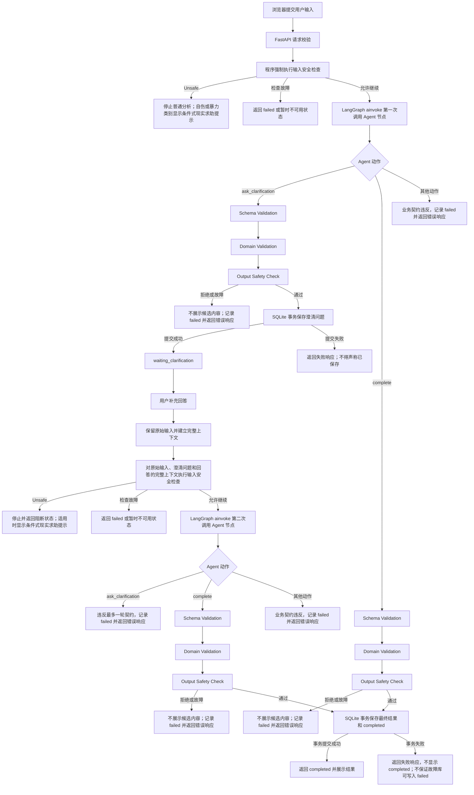

# Emora MVP 技术设计文档

本文是唯一技术设计文档，定义 MVP 技术栈、完整文件结构和各文件的代码职责。MVP 复用当前仓库中可用的实现；当前组件不适配目标技术栈时，记录具体边界后做最小替换，不为架构完整性增加平台。开发过程与尚未解决的设计风险分别记入 `doc/DEVELOPMENT_LOG.md` 和 `doc/TECHNICAL_DEBT.md`，这两份记录不替代本设计文档。

## 1. 第一阶段技术栈

| 层次 | 选型 | 依据与集成成本 |
|---|---|---|
| 后端 | FastAPI | 提供独立 JSON API 和前端应用入口；业务逻辑只由 API 路由调用服务层。 |
| Web 服务 | Uvicorn | FastAPI 的轻量 ASGI 服务。 |
| 前端 | HTML、CSS、JavaScript | 浏览器原生能力满足输入、澄清、结果和历史记录，不增加前端构建工程。 |
| 页面模板 | Jinja2 | 仅渲染不含业务数据的前端应用外壳；与 FastAPI 集成成本低。 |
| 数据校验 | Pydantic | 沿用当前数据契约；只复用 MVP 所需契约，避免引入运行时元数据。 |
| 数据库 | SQLite | 符合单机 MVP。现有 PostgreSQL 仓储含 PostgreSQL 专属 SQL、锁及多套状态，不能直接替换连接串；复用可用的数据契约和 CRUD 语义，SQLite 持久化仅实现必要读写。 |
| 模型接入 | OpenAI Python SDK 兼容接口 | 当前 Provider 已使用 `AsyncOpenAI`；直接声明 `openai` 依赖并薄适配。现有同步包装在 FastAPI 异步请求中需避免阻塞或嵌套事件循环。 |
| Agent 编排 | LangGraph `1.2.18` | 截至 2026-10-30，PyPI 最新发布为 `1.2.18`（2026-10-27）。新项目采用小型 `StateGraph` 承载单个 Emora Agent 调用，不迁移旧图结构、checkpoint 和运行时元数据。 |
| 自动化测试 | pytest | 仅用于应用/组件可启动、健康接口、数据库和已配置外部 endpoint 的可达性与连通性排查，不测试业务行为。 |
| 安全 | Qwen3Guard-Gen，经 vLLM OpenAI-compatible API 接入 | 官方提供 Gen 静态提示/回复分类和 vLLM OpenAI 兼容服务方式；Emora 复用 `openai` SDK 调用，不新增 Agent 工具。Gen 模型尺寸根据可用硬件配置为官方 0.6B、4B 或 8B 检查点。 |

不引入 Vue、React、Django、Redis、PostgreSQL、消息队列或分布式组件。依赖版本在项目锁文件中固定为 `langgraph==1.2.18`，后续升级另行评估。

### 前后端分离边界

MVP 要求前后端分别放在根目录的 `frontend/` 与 `backend/` 文件夹中，并按 HTTP 契约通信；暂不要求独立仓库、独立域名或独立部署。前端由 `frontend/templates/index.html`、`frontend/static/app.js` 和 `frontend/static/styles.css` 组成，只负责界面、交互和 API 响应呈现；后端由 `backend/` 下的 FastAPI 路由、服务和依赖组成，只负责请求契约、业务调用和 JSON 响应。双方只通过本文件列出的 `/api/...` 请求/响应模型交换数据。

Jinja2 只生成静态应用外壳，不向模板注入分析记录、Agent 状态或业务决策；页面加载后，前端通过 `fetch()` 调用 JSON API 获取和提交数据。FastAPI 从 `frontend/` 提供页面入口和静态资源，以保持 MVP 部署简单，但 `backend/` 与 `frontend/` 在文件系统中保持分离，页面路由与 JSON API 路由职责分明。前端不得访问 Python 服务对象或数据库；API 不生成具体页面内容或承担前端状态管理。

## 2. 复用边界与安全执行约束

- `packages_py/providers.py`：复用现有 OpenAI 兼容 Provider 的请求、结构化响应和错误处理；在 `backend/provider.py` 按 FastAPI 异步调用方式做最小适配。
- `packages_py/schemas.py`：复用适用于 MVP 的 Pydantic 契约，映射到 `backend/contracts.py`。当前带运行、检查点和版本信息的字段不进入 Web API 契约。
- `packages_py/workflow.py`：仅作为理解现有 Provider/Agent 行为的参考，不直接复用旧有图、节点、checkpoint 状态或运行元数据。新项目在 `backend/agent.py` 使用自己的最小图契约，避免旧工作流字段和持久化语义渗入新业务。
- `packages_py/storage.py`：当前实现是 PostgreSQL 专用，不能直接用于 SQLite。仅在 `backend/storage.py` 复用必要数据实体和读写语义；不搬入检查点、候选发布、多版本协调和生命周期设施。
- `packages_py/safety.py`：当前为自定义关键词分类，不复用其分类算法。MVP 的 `backend/safety.py` 薄适配 Qwen3Guard-Gen 的 OpenAI-compatible endpoint；不实现分类体系、关键词表或规则引擎。

输入和输出安全检查是应用边界的强制条件，不是 Agent 可选工具：

1. 服务层在每次 Agent 调用前用 Qwen3Guard-Gen 检查输入。`Safe` 和 `Controversial` 保留原始标签并允许进入情境分析；`Unsafe` 阻止普通分析。若结果同时为 `Unsafe` 且类别包含 `Suicide & Self-Harm` 或 `Violent`，页面可显示 PRD 定义的基本求助提示，但文案不得断言模型已确认即时危险。
2. Agent 生成的每个结果在保存或展示前都必须通过输出检查；检查拒绝时不得标记为完成或向用户展示该结果。
3. 安全组件不可用或检查失败时，分析不能绕过检查继续完成；返回暂时不可用状态，不把技术故障伪装成风险判断。
4. 使用 Qwen3Guard-Gen 自身的 `Safety`、`Categories` 和（回复审查时）`Refusal` 字段，不在 Emora 中另建风险分类或改写类别。程序只依据明确的产品门禁规则决定是否继续/发布。

Qwen3Guard 输出的严重度和类别按官方字段保留。它提供内容安全分类，不提供“用户本人是否正在发生/是否迫在眉睫”的独立字段；`Suicide & Self-Harm`、`Violent` 等标签也不能单独证明用户的个人意图或即时危险。Emora 不得把 `Unsafe` 或某个类别直接描述成临床判断或确定的即时危险。产品要求的基本现实世界求助提示只能作为谨慎的产品响应呈现，不代表 Qwen3Guard 已识别个人危机；仅依靠通用内容分类能否满足 PRD 的高风险求助识别仍需在真实使用前单独确认，不得在文档中宣称已验证覆盖。

官方接入依据：[QwenLM/Qwen3Guard README](https://github.com/QwenLM/Qwen3Guard) 的 Quick Start、Deployment with SGLang and vLLM、Safety Policy。MVP 采用 `Qwen3Guard-Gen`，通过同机 vLLM OpenAI-compatible HTTP server 调用；不采用 Stream 变体，因为本产品流程是完整请求/响应检查，不是逐 token 流式拦截。官方 Gen 检查点为 `Qwen/Qwen3Guard-Gen-0.6B`、`Qwen/Qwen3Guard-Gen-4B`、`Qwen/Qwen3Guard-Gen-8B`；Emora 配置必须与 vLLM 实际加载的检查点一致。具体尺寸由部署机器资源决定。

官方给出的 vLLM 版本要求为 `vllm>=0.9.0`，并提供命令：

```bash
vllm serve Qwen/Qwen3Guard-Gen-4B --port 8001 --max-model-len 32768
```

此命令示例使用 4B 检查点；部署时可替换成上列其他 Gen 检查点。vLLM 是独立模型服务进程，不作为 Emora Web 项目的 Python 运行依赖；Emora 通过 `http://127.0.0.1:8001/v1` 调用。

2026-10-30 本机部署补充：Apple Silicon Mac 使用官方 Transformers 推理方式，通过 `install-guard.sh` 在隔离的 `.guard-venv` 安装运行时，下载官方 0.6B/4B/8B checkpoint 到 `.guard-models/`。`scripts/guard_server.py` 只负责 OpenAI-compatible HTTP 传输与官方 `apply_chat_template`/`generate` 调用，优先使用 MPS；不实现额外分类规则。`start-guard.sh` 固定监听独立的 Guard 端口，Web 仍复用同一个 OpenAI SDK 客户端。vLLM 外部服务与 Mac Transformers 服务二选一，不在同一端口同时启动；安装和运维命令见 `OPERATIONS.md`。

### Agent 决策权与程序控制权

安全检查和结果校验不是 Agent 工具，也不属于 Agent 可以选择的下一步。程序控制权和 Agent 决策权明确分离：

| 控制点 | 程序负责 | Agent 负责 |
|---|---|---|
| 输入安全门 | 强制调用输入安全组件；`Unsafe` 分类阻止普通分析，检查故障时停止分析并返回不可用状态 | 不得跳过、重试或改写门禁结果 |
| 分析过程 | 提供完整上下文、调用 Agent、限制超时 | 理解情境、决定是否需要澄清、生成候选分析 |
| 输出安全门 | 强制调用输出安全组件；未通过时不保存为完成结果、不展示给用户 | 不得声明已通过或绕过检查 |
| 业务完整性 | 根据 Pydantic 契约检查结果 | 提供符合契约的候选内容 |
| 状态发布 | 所有门禁通过后才写入 `completed` | 不直接写数据库、不改变状态 |

因此，`backend/safety.py` 由 `backend/services.py` 固定调用，不能注册到 Agent 的工具列表。Agent 不能调用安全检查、结果检查、数据库写入或状态发布函数。

## 3. 完整文件系统结构

```text
emora-mvp-standalone/
├── README.md                       # 安装、配置、启动、测试和当前范围说明
├── pyproject.toml                  # Python 项目元数据及运行/开发依赖；Qwen 权重服务不装入 Web 环境
├── .env.example                    # Emora 与 Qwen3Guard endpoint 环境变量，不含真实密钥
├── .gitignore                      # 忽略本地密钥、数据库、缓存和虚拟环境
├── backend/                        # FastAPI 与全部服务端 Python 代码
│   ├── __init__.py                 # 使 backend 可通过模块路径启动
│   ├── app.py                      # FastAPI 生命周期、页面/API 路由和异常映射
│   ├── config.py                   # 应用和 Qwen3Guard endpoint 配置及脱敏摘要
│   ├── logging_config.py           # 标准库日志初始化、请求关联 ID 与 HTTP 请求日志
│   ├── contracts.py                # Pydantic 请求、Agent、结果、安全及响应契约
│   ├── provider.py                 # OpenAI Python SDK 兼容 Provider 薄适配
│   ├── agent.py                    # LangGraph StateGraph、图状态和单 Agent 节点
│   ├── safety.py                   # Qwen3Guard-Gen 客户端及结果解析
│   ├── storage.py                  # SQLite 分析记录读写及事务提交
│   ├── services.py                 # 固定执行安全门、Agent、校验和持久化边界
│   ├── prompts/                    # Agent 提示词资源
│   │   └── system.md               # Agent 的角色、分析要求和输出要求
│   ├── data/                       # 本地 SQLite 数据目录
│   │   └── .gitkeep                # 在版本库中保留空数据目录
│   └── tests/                      # 后端基础设施可达性和连通性检查
│       └── test_infrastructure.py  # 应用、数据库及 endpoint 基础检查
├── frontend/                       # 与 backend/ 物理分离的浏览器端文件
│   ├── templates/                  # Jinja2 应用外壳，不渲染业务数据
│   │   └── index.html              # 前端入口结构，加载静态资源
│   └── static/                     # 浏览器静态资源
│       ├── app.js                  # 页面交互、JSON API 请求和响应呈现
│       └── styles.css              # 页面基础样式和移动端适配
├── doc/                            # 产品与技术设计文档
│   ├── PRD.md                      # 唯一产品需求文档
│   ├── TECHNICAL_DESIGN.md         # 唯一技术设计文档
│   ├── FRONTEND_DESIGN.md          # 前端视觉、布局与交互设计
│   ├── FRONTEND_PREVIEW.html       # 不连接后端的静态界面预览
│   ├── DEVELOPMENT_LOG.md          # 按时间追加的开发决策、文档变更和核验记录
│   └── TECHNICAL_DEBT.md           # 尚未解决的技术与验证风险、影响和处理条件
```

后端以仓库根目录为工作目录运行：`uvicorn backend.app:app`。`pyproject.toml` 保持在根目录统一管理 Python 依赖与 pytest 配置；测试文件位于 `backend/tests/`。`backend/` 与 `frontend/` 不互相导入代码，通信只通过 JSON API。

## 4. 文件代码大致设计

### `README.md`

说明安装、环境变量、启动命令、测试命令、SQLite 文件位置、复用模块位置，以及同机启动 Qwen3Guard vLLM 服务的命令。明确模型尺寸需匹配部署硬件。

### `pyproject.toml`

声明 Python 版本和直接依赖：`fastapi`、`uvicorn`、`jinja2`、`pydantic`、`pydantic-settings`、`python-dotenv`、`openai`、`sqlalchemy`、`langgraph==1.2.18`。`pytest` 和 FastAPI 测试所需依赖放在开发依赖中。`vllm>=0.9.0` 安装在提供 Qwen3Guard 权重服务的本机运行环境，不放入 Emora Web 项目的依赖，以免把大型推理运行时带入应用环境。

### `.env.example`

列出分析模型配置、Qwen3Guard endpoint 配置、SQLite URL、请求超时和最大输入长度。Qwen3Guard 的本机 vLLM 默认不启用鉴权，OpenAI SDK 的占位 Key 使用 `EMPTY`；若部署端点启用鉴权则使用本地密钥，不提交真实值。

```env
EMORA_MODEL=
EMORA_API_KEY=
EMORA_API_BASE=
EMORA_DATABASE_URL=sqlite:///backend/data/emora.db
EMORA_REQUEST_TIMEOUT_SECONDS=30
EMORA_MAX_INPUT_LENGTH=10000
EMORA_QWEN_GUARD_BASE_URL=http://127.0.0.1:8001/v1
EMORA_QWEN_GUARD_API_KEY=EMPTY
EMORA_QWEN_GUARD_MODEL=Qwen/Qwen3Guard-Gen-4B
EMORA_QWEN_GUARD_TIMEOUT_SECONDS=15
```

`EMORA_QWEN_GUARD_MODEL` 必须和 `vllm serve` 启动参数使用的检查点一致；`4B` 仅为示例，可按硬件改为官方 `0.6B` 或 `8B` 检查点。

### `.gitignore`

忽略 `.env`、虚拟环境、Python 缓存、pytest 缓存和 `backend/data/*.db`。

### `backend/logging_config.py`

使用 Python 标准库 `logging` 配置统一日志格式和级别，输出到标准错误流，由 Uvicorn 或运行环境收集；不添加日志服务、日志数据库或新依赖。每个 HTTP 请求生成服务端 request ID，在响应头返回 `X-Request-ID`，并在请求日志及错误日志中使用同一 ID 关联。请求日志记录方法、无查询参数的路径、HTTP 状态码和耗时；应用启动、关闭、资源释放异常和未预期异常也写入日志。

禁止记录请求体、用户原始描述、澄清回答、模型提示词和回复、安全分类原文、Authorization/Cookie、API Key、完整数据库连接串及其他凭据。异常日志只记录异常类型和堆栈帧，不记录异常消息文本，避免上游异常回显用户内容；HTTP 响应只返回通用错误码。日志内容应使用固定事件名和受控字段，不拼接用户提供的文本。

```python
import logging
import logging.config
from contextvars import ContextVar
from time import perf_counter
from traceback import format_tb
from uuid import uuid4

request_id_var: ContextVar[str] = ContextVar("request_id", default="-")

class RequestIdFilter(logging.Filter):
    def filter(self, record):
        if not getattr(record, "request_id", None):
            record.request_id = request_id_var.get()
        return True

def configure_logging():
    logging.config.dictConfig({
        "version": 1,
        "disable_existing_loggers": False,
        "filters": {"request_id": {"()": RequestIdFilter}},
        "formatters": {
            "standard": {
                "format": "%(asctime)s %(levelname)s %(name)s request_id=%(request_id)s %(message)s"
            }
        },
        "handlers": {
            "stderr": {
                "class": "logging.StreamHandler",
                "formatter": "standard",
                "filters": ["request_id"],
            }
        },
        "root": {"level": "INFO", "handlers": ["stderr"]},
    })

def install_request_logging(app):
    @app.middleware("http")
    async def log_request(request, call_next):
        request_id = uuid4().hex
        request.state.request_id = request_id
        token = request_id_var.set(request_id)
        started = perf_counter()
        try:
            response = await call_next(request)
            response.headers["X-Request-ID"] = request_id
            logging.getLogger("emora.http").info(
                "http_request_completed method=%s path=%s status=%s duration_ms=%.1f",
                request.method,
                request.url.path,
                response.status_code,
                (perf_counter() - started) * 1000,
            )
            return response
        finally:
            request_id_var.reset(token)
```

`backend/app.py` 调用 `configure_logging()` 并安装请求日志中间件；lifespan 记录成功启动、生命周期异常和资源释放事件。统一异常处理器记录异常类型、堆栈帧及 `request.state.request_id`，并将 request ID 放入响应头；不得把堆栈或内部细节返回给前端。已知业务错误按预期级别记录，不重复输出堆栈；未预期异常记录一次诊断信息，避免输出异常消息文本。日志输出到标准错误流，不承担审计、用户行为分析、日志轮转或长期留存保证；这些由运行环境在有需要时负责。

### `backend/app.py`

FastAPI 是 MVP 的后端 HTTP 边界层，负责以下职责：

- 创建 FastAPI 应用实例；
- 在启动和关闭时初始化或释放 SQLite、Provider 和服务对象；
- 接收 HTTP 请求并使用 Pydantic 解析请求体；
- 调用 `backend.services`，将服务结果转换为 HTTP JSON 响应；
- 使用 Jinja2 返回不含业务数据的前端应用外壳；
- 挂载 `frontend/static/` 静态资源；
- 提供健康检查接口，供基础设施连通性测试使用；
- 将已知业务异常映射为明确的 HTTP 状态码；
- 不在路由中实现分析、安全判断、Agent 决策或数据库 SQL。

FastAPI 不负责：

- 判断用户是否存在风险；
- 决定是否需要澄清；
- 调用安全组件的具体实现；
- 生成情感分析内容；
- 直接读写 SQLite；
- 代替 Agent 编排业务流程。

页面入口只返回应用外壳；JSON API 路由只解析契约、调用服务并返回 JSON，不渲染分析页面。代码结构大致如下：

```python
from contextlib import asynccontextmanager
import inspect
import logging
from pathlib import Path
from traceback import format_tb
from fastapi import FastAPI, Request
from fastapi.responses import HTMLResponse
from fastapi.staticfiles import StaticFiles
from fastapi.templating import Jinja2Templates
from backend.logging_config import configure_logging, install_request_logging
from backend.contracts import (
    AnalysisListResponse,
    AnalysisRequest,
    AnalysisResponse,
    ClarificationRequest,
    HealthResponse,
)

logger = logging.getLogger(__name__)
configure_logging()
PROJECT_ROOT = Path(__file__).resolve().parent.parent
FRONTEND_DIR = PROJECT_ROOT / "frontend"

async def close_resource(resource):
    if resource is None:
        return
    # Provider/客户端使用 close()；SQLAlchemy Engine 使用 dispose()
    close = getattr(resource, "close", None) or getattr(resource, "dispose", None)
    if close is None:
        return
    try:
        result = close()
        if inspect.isawaitable(result):
            await result
    except Exception:
        # 记录关闭故障但继续释放其他已创建资源
        logger.error(
            "resource_close_failed error_type=%s traceback=%s",
            type(exc).__name__,
            "".join(format_tb(exc.__traceback__)),
        )

@asynccontextmanager
async def lifespan(app: FastAPI):
    database = provider = guard = agent_graph = service = None
    try:
        # 初始化顺序：数据库 -> Provider -> 安全客户端 -> Agent 图 -> Service
        database = build_database()
        database.init_db()
        provider = build_provider()
        guard = build_safety_client()
        agent_graph = build_agent_graph(provider=provider)
        service = build_analysis_service(
            database=database, provider=provider, guard=guard, agent_graph=agent_graph
        )
        app.state.database = database
        app.state.provider = provider
        app.state.guard = guard
        app.state.agent_graph = agent_graph
        app.state.service = service
        logger.info("application_started")
        yield
    except Exception:
        logger.error(
            "application_lifecycle_failed error_type=%s traceback=%s",
            type(exc).__name__,
            "".join(format_tb(exc.__traceback__)),
        )
        raise
    finally:
        # 初始化失败或正常关闭都执行；按已成功创建资源的逆序释放
        # close_resource 同时支持同步 close() 和异步 close()
        await close_resource(service)
        await close_resource(agent_graph)
        await close_resource(guard)
        await close_resource(provider)
        await close_resource(database)
        logger.info("application_resources_released")

app = FastAPI(title="Emora MVP", lifespan=lifespan)
install_request_logging(app)
app.mount(
    "/static",
    StaticFiles(directory=FRONTEND_DIR / "static"),
    name="static",
)
templates = Jinja2Templates(directory=FRONTEND_DIR / "templates")

@app.get("/", response_class=HTMLResponse)
async def index(request: Request):
    return templates.TemplateResponse("index.html", {"request": request})

@app.get("/health", response_model=HealthResponse)
async def health(request: Request):
    return {"status": "ok"}

@app.post("/api/analyses", response_model=AnalysisResponse)
async def create_analysis(request: AnalysisRequest, http_request: Request):
    return await http_request.app.state.service.create(request.text)

@app.get("/api/analyses", response_model=AnalysisListResponse)
async def list_analyses(http_request: Request):
    return {"items": http_request.app.state.service.list()}

@app.get("/api/analyses/{analysis_id}", response_model=AnalysisResponse)
async def get_analysis(analysis_id: str, http_request: Request):
    return http_request.app.state.service.get(analysis_id)

@app.post(
    "/api/analyses/{analysis_id}/clarify",
    response_model=AnalysisResponse,
)
async def clarify(
    analysis_id: str,
    request: ClarificationRequest,
    http_request: Request,
):
    return await http_request.app.state.service.continue_with_answer(
        analysis_id, request.answer
    )
```

接口契约保持如下对应关系：

| 方法和路径 | 请求模型 | 成功响应模型 | 主要失败状态 |
|---|---|---|---|
| `POST /api/analyses` | `AnalysisRequest{text, deep_thinking=false, reasoning_effort=medium}` | `AnalysisResponse` | `422`、`503`、`500` |
| `POST /api/analyses/stream` | `AnalysisRequest{text, deep_thinking=false, reasoning_effort=medium}` | `text/event-stream`：`status`、`progress`、深度模式 `analysis`、`delta`、`complete` 或 `error` | `422`、流内业务错误 |
| `GET /api/analyses` | 无 | `AnalysisListResponse{items}` | `500` |
| `GET /api/analyses/{analysis_id}` | 路径参数 `analysis_id: str` | `AnalysisResponse` | `404`、`500` |
| `POST /api/analyses/{analysis_id}/clarify` | `ClarificationRequest{answer, deep_thinking?, reasoning_effort?}` | `AnalysisResponse` | `404`、`422`、`503`、`500` |
| `POST /api/analyses/{analysis_id}/clarify/stream` | `ClarificationRequest{answer, deep_thinking?, reasoning_effort?}` | `text/event-stream`：`status`、`progress`、深度模式 `analysis`、`delta`、`complete` 或 `error` | `404`、流内业务错误 |
| `GET /api/runtime` | 无 | `RuntimeInfoResponse{model_name, reasoning_efforts, default_reasoning_effort}` | `500` |
| `GET /health` | 无 | `HealthResponse{status}` | `500` |

FastAPI/Pydantic 自动处理类型、必填字段、空白值和额外字段错误并返回 `422`；运行时最大长度由 `backend.services` 使用 `Settings.max_input_length` 检查。

应用还应注册统一异常处理器。已知业务异常映射为其对应 HTTP 状态码；未预期异常只记录内部诊断信息并返回通用 `500`，不暴露密钥、堆栈或内部敏感信息。不同异常不能全部映射为 `503`，任何异常都不得转换为 `completed`。

```python
from fastapi.responses import JSONResponse
from backend.services import BusinessError

@app.exception_handler(BusinessError)
async def handle_business_error(request: Request, exc: BusinessError):
    request_id = getattr(request.state, "request_id", "-")
    logger.warning(
        "business_error code=%s request_id=%s",
        exc.code,
        request_id,
    )
    return JSONResponse(
        status_code=exc.status_code,
        content={"error": exc.code},
        headers={"X-Request-ID": request_id},
    )

@app.exception_handler(Exception)
async def handle_unexpected_error(request: Request, exc: Exception):
    request_id = getattr(request.state, "request_id", "-")
    logger.error(
        "unexpected_application_error error_type=%s request_id=%s traceback=%s",
        type(exc).__name__,
        request_id,
        "".join(format_tb(exc.__traceback__)),
        extra={"request_id": request_id},
    )
    return JSONResponse(
        status_code=500,
        content={"error": "internal_error"},
        headers={"X-Request-ID": request_id},
    )
```

路由函数保持薄层设计：解析请求、调用服务、返回响应。所有输入安全门、Agent 调用、Schema Validation、Domain Validation、Output Safety Check 和事务保存都在 `backend.services` 中按固定程序顺序执行。

### `backend/config.py`

使用 Pydantic Settings 从环境读取配置，并提供隐藏密钥的诊断摘要。配置来源保持单一、可见。`max_input_length` 不得超过 `backend/contracts.py` 中的 `MAX_INPUT_LENGTH`。

```python
from pydantic_settings import BaseSettings, SettingsConfigDict
from pydantic import Field, field_validator, SecretStr
from backend.contracts import MAX_INPUT_LENGTH

class Settings(BaseSettings):
    model_config = SettingsConfigDict(env_prefix="EMORA_", env_file=".env")
    model: str
    api_key: SecretStr
    api_base: str | None = None
    database_url: str = "sqlite:///backend/data/emora.db"
    request_timeout_seconds: float = 30
    max_input_length: int = Field(default=MAX_INPUT_LENGTH, gt=0)
    qwen_guard_base_url: str = "http://127.0.0.1:8001/v1"
    qwen_guard_api_key: SecretStr = SecretStr("EMPTY")
    qwen_guard_model: str = "Qwen/Qwen3Guard-Gen-4B"
    qwen_guard_timeout_seconds: float = 15

    @field_validator("max_input_length")
    @classmethod
    def input_limit_cannot_exceed_contract_cap(cls, value: int) -> int:
        if value > MAX_INPUT_LENGTH:
            raise ValueError("max_input_length exceeds contract cap")
        return value

def get_config_summary(settings: Settings) -> dict:
    return {
        "analysis_model": settings.model,
        "analysis_api_base": settings.api_base,
        "database_url": redact_database_credentials(settings.database_url),
        "request_timeout_seconds": settings.request_timeout_seconds,
        "qwen_guard_base_url": settings.qwen_guard_base_url,
        "qwen_guard_model": settings.qwen_guard_model,
        "qwen_guard_timeout_seconds": settings.qwen_guard_timeout_seconds,
        "secret_values_exposed": False,
    }
```

`qwen_guard_api_key` 只用于 SDK 初始化，不得写入配置诊断或日志。`redact_database_credentials()` 只遮蔽 URL 中的凭据，不做其他配置读取。

### `backend/contracts.py`

复用或薄适配 `packages_py/schemas.py` 中的 Pydantic 数据契约，统一定义 Web 请求、Agent 候选结果、SQLite 记录和 API 响应字段。`backend/app.py` 只能使用这里定义的请求和响应模型；模型输出也必须先解析为同一份 Pydantic 契约。浏览器端不导入 Python 契约代码，只遵守对应的 JSON 字段约定。

```python
from datetime import datetime
from enum import Enum
from pydantic import BaseModel, ConfigDict, Field, field_validator, model_validator
from typing import Literal

MAX_INPUT_LENGTH = 10_000

class Contract(BaseModel):
    model_config = ConfigDict(extra="forbid")

class AnalysisStatus(str, Enum):
    WAITING_CLARIFICATION = "waiting_clarification"
    COMPLETED = "completed"
    BLOCKED = "blocked"
    FAILED = "failed"

class AnalysisRequest(Contract):
    text: str = Field(min_length=1, max_length=MAX_INPUT_LENGTH)
    deep_thinking: bool = False
    reasoning_effort: Literal["none", "low", "medium", "high", "xhigh", "max"] = "medium"

    @field_validator("text")
    @classmethod
    def text_must_not_be_blank(cls, value: str) -> str:
        if not value.strip():
            raise ValueError("text must not be blank")
        return value

class ClarificationRequest(Contract):
    answer: str = Field(min_length=1, max_length=MAX_INPUT_LENGTH)
    deep_thinking: bool | None = None
    reasoning_effort: Literal["none", "low", "medium", "high", "xhigh", "max"] | None = None

    @field_validator("answer")
    @classmethod
    def answer_must_not_be_blank(cls, value: str) -> str:
        if not value.strip():
            raise ValueError("answer must not be blank")
        return value

class AnalysisResult(Contract):
    summary: str
    emotions: list[str]
    conflict: str
    user_needs: str
    suggestions: list[str] = Field(min_length=1)
    next_step: str
    safety_note: str | None = None

class QwenSafetyLevel(str, Enum):
    SAFE = "Safe"
    CONTROVERSIAL = "Controversial"
    UNSAFE = "Unsafe"

class QwenSafetyCategory(str, Enum):
    VIOLENT = "Violent"
    NON_VIOLENT_ILLEGAL_ACTS = "Non-violent Illegal Acts"
    SEXUAL_CONTENT_OR_ACTS = "Sexual Content or Sexual Acts"
    PII = "PII"
    SUICIDE_SELF_HARM = "Suicide & Self-Harm"
    UNETHICAL_ACTS = "Unethical Acts"
    POLITICALLY_SENSITIVE_TOPICS = "Politically Sensitive Topics"
    COPYRIGHT_VIOLATION = "Copyright Violation"
    JAILBREAK = "Jailbreak"
    NONE = "None"

class QwenSafetyPhase(str, Enum):
    INPUT = "input"
    OUTPUT = "output"

class Qwen3GuardResult(Contract):
    phase: QwenSafetyPhase
    safety: QwenSafetyLevel
    categories: list[QwenSafetyCategory]
    refusal: Literal["Yes", "No"] | None = None
    model_id: str

class AgentAction(str, Enum):
    ASK_CLARIFICATION = "ask_clarification"
    COMPLETE = "complete"

class AgentDecision(Contract):
    action: AgentAction
    clarification_question: str | None = None
    result: AnalysisResult | None = None

    @model_validator(mode="after")
    def action_matches_payload(self):
        if self.action == AgentAction.ASK_CLARIFICATION:
            if not self.clarification_question or not self.clarification_question.strip():
                raise ValueError("clarification_question is required")
            if self.result is not None:
                raise ValueError("clarification result must be null")
        if self.action == AgentAction.COMPLETE and self.result is None:
            raise ValueError("result is required")
        return self

class AnalysisResponse(Contract):
    id: str
    original_input: str
    deep_thinking: bool = False
    reasoning_effort: Literal["none", "low", "medium", "high", "xhigh", "max"] = "medium"
    status: AnalysisStatus
    clarification_question: str | None = None
    result: AnalysisResult | None = None
    safety_level: QwenSafetyLevel | None = None
    safety_categories: list[QwenSafetyCategory] = Field(default_factory=list)
    error_code: str | None = None
    created_at: datetime
    updated_at: datetime

class AnalysisListResponse(Contract):
    items: list[AnalysisResponse]

class AnalysisRecord(Contract):
    id: str
    original_input: str
    deep_thinking: bool = False
    reasoning_effort: Literal["none", "low", "medium", "high", "xhigh", "max"] = "medium"
    clarification_question: str | None = None
    clarification_answer: str | None = None
    result: AnalysisResult | None = None
    status: AnalysisStatus
    input_safety_level: QwenSafetyLevel | None = None
    input_safety_categories: list[QwenSafetyCategory] = Field(default_factory=list)
    error_code: str | None = None
    created_at: datetime
    updated_at: datetime

class HealthResponse(Contract):
    status: str
```

`AnalysisRequest` 和 `ClarificationRequest` 由 FastAPI/Pydantic 负责类型、必填、额外字段、非空、非空白和 `MAX_INPUT_LENGTH` 硬上限校验；超限自动返回 `422`。`backend/config.py` 中的 `max_input_length` 可以设置更小的运行时限制，必须由 `backend/services.py` 对原始文本和补充回答分别执行，且不能超过 `MAX_INPUT_LENGTH`。`Qwen3GuardResult` 保留官方严重度、类别和回复审查时的 Refusal 字段；其中 `phase` 与 `model_id` 是 Emora 客户端附加的调用元数据，不是 Qwen 返回字段。Qwen 的 `Categories: None` 按 `QwenSafetyCategory.NONE` 保留。Schema Validation 只说明字段和类型符合契约；Domain Validation 还必须检查完成结果的必要内容，不宣称分析在语义上正确或有用。`AnalysisStatus` 不含 `pending`：浏览器在 SSE 连接期间显示本地处理中状态；持久化状态仍为 `waiting_clarification`、`completed`、`blocked` 或 `failed`。

`AnalysisRequest.deep_thinking` 是默认关闭的可选产品模式；`reasoning_effort` 支持 `none`、`low`、`medium`、`high`、`xhigh`、`max` 六档，默认 `medium`。澄清请求中的两个字段均可省略；省略时沿用数据库记录的当前值，显式值则更新当前分析。`AnalysisResponse` 返回实际采用并持久化的模式和档位，历史会话据此恢复控件。`GET /api/runtime` 返回 Provider 当前模型名和这组六档能力声明，供 composer 初始化显示。

### `backend/provider.py`

薄适配现有 `OpenAICompatibleProvider` 或直接使用 OpenAI Python SDK 的异步客户端。只处理模型请求、结构化响应、超时和 Provider 错误，不处理安全策略、数据库或业务路由。

当前 Ruoli 配置使用文档支持的 `chat.completions.create(stream=true)`，并按 GPT-5.6 Terra 兼容接口约定发送 `reasoning_effort`。普通模式只生成正式分析。深度模式先生成 `PublicAnalysisBrief`，通过 Qwen 输出 Guard 后才以 SSE `analysis` 事件显示，并作为后续 `AgentDecision` 调用的上下文；第二阶段使用 `max_completion_tokens=4096`，在可信 system 提示中要求区分事实与假设、分析因素关系、给出更具体且有优先级的建议。提要是面向用户的简短解释，不是模型私有思维链。中转站是否继续透传并实际改变上游推理资源，不能仅由请求被接受推断，仍需服务商端证据。不假定兼容网关支持原生 `response_format=json_schema` 或 SDK `parse`；将目标 JSON Schema 放入可信 system 提示，明确只返回一个 JSON 对象。Provider 消费每次完整 SSE 流后才执行严格 JSON 反序列化，拒绝空响应、非对象和未完成生成，不从任意文本中截取 JSON、不生成回退结果；`AnalysisService` 仍是正式 `AgentDecision` 的唯一 Pydantic Schema/Domain Validation 位置。正式答复在输出 Guard 和数据库事务完成前不会转发给浏览器。

```python
class ProviderAdapter:
    async def complete(self, messages: list[dict], response_model: type):
        """通过 OpenAI 兼容接口获取符合 Pydantic 契约的响应。"""
        ...
```

### `backend/agent.py`

新项目的 LangGraph 边界只负责在单次服务调用中运行 Emora Agent 节点并返回结构化决策载荷 `dict`；`backend/services.py` 在图返回后将其校验为 `AgentDecision`。图不负责 FastAPI 请求、输入/输出安全门、业务校验、SQLite 访问、API 状态映射或跨请求恢复。

图在应用 lifespan 初始化时构建并编译一次，后续请求复用已编译图。使用 `ainvoke()` 以适配 FastAPI 异步请求；不在每次请求中重新创建或编译图。图不配置 checkpointer：跨请求的原始输入、澄清问题和回答由 `backend/services.py` 从 SQLite 读取并显式放入下一次图调用状态。这样不引入 checkpoint、thread id 或第二套权威状态。

图状态是 `backend/agent.py` 内部数据契约，仅包含本次分析所需字段：

```python
from typing import Literal, TypedDict
from langgraph.graph import StateGraph, START, END
from backend.contracts import AgentDecision

class EmoraGraphState(TypedDict):
    original_input: str
    clarification_question: str | None
    clarification_answer: str | None
    clarification_round: Literal[0, 1]  # 0 首次调用，1 用户补充后的调用
    deep_thinking: bool
    decision: dict | None

class EmoraAgentGraph:
    def __init__(self, agent):
        self.agent = agent
        builder = StateGraph(EmoraGraphState)
        builder.add_node("agent", self._agent_node)
        builder.add_edge(START, "agent")
        builder.add_edge("agent", END)
        self.graph = builder.compile()

    async def _agent_node(self, state: EmoraGraphState) -> dict:
        decision = await self.agent.decide({
            "original_input": state["original_input"],
            "clarification_question": state["clarification_question"],
            "clarification_answer": state["clarification_answer"],
            "clarification_round": state["clarification_round"],
        }, deep_thinking=state["deep_thinking"])
        return {"decision": decision}

    async def ainvoke(self, *, original_input: str,
                      clarification_question: str | None = None,
                      clarification_answer: str | None = None,
                      clarification_round: Literal[0, 1] = 0,
                      deep_thinking: bool = False) -> dict:
        state = await self.graph.ainvoke({
            "original_input": original_input,
            "clarification_question": clarification_question,
            "clarification_answer": clarification_answer,
            "clarification_round": clarification_round,
            "deep_thinking": deep_thinking,
            "decision": None,
        })
        return state["decision"]
```

`EmoraAgentGraph` 在 `AnalysisService` 初始化时创建一次，内部完成 `StateGraph` 的构建和编译；之后服务通过 `ainvoke()` 复用已编译图。`EmoraGraphState` 输入由 `backend/services.py` 显式构造；节点只调用 Agent 并写回决策。`AgentDecision` 使用 `backend/contracts.py` 中的 Pydantic 契约。LangGraph state 中的 `clarification_round` 不代替服务端约束：服务层在首次调用传 `0`，用户补充后传 `1`，并且在第二次调用返回后拒绝 `ask_clarification`，记为 `failed`，不得再次调用图。该限制由程序执行，不依赖 Prompt 或模型遵守。

LangGraph 状态与调用契约如下：

| 字段/接口 | 类型 | 写入方 | 读取方与约束 |
|---|---|---|---|
| `original_input` | `str` | `backend/services.py` 从请求或 SQLite 记录构造 | Agent 必须在两次调用中都收到原始描述；不得被补充回答覆盖 |
| `clarification_question` | `str \| None` | 首轮 `AgentDecision` 经校验后由服务保存；后续从 SQLite 读取 | 首次调用为 `None`；续答调用携带已保存问题 |
| `clarification_answer` | `str \| None` | 首次调用为 `None`；续答时由服务读取用户回答 | 续答调用必须包含回答；原始描述和问题同时保留 |
| `clarification_round` | `Literal[0, 1]` | `backend/services.py` | 0 表示首次调用，1 表示唯一一次续答；越界值由服务拒绝，不依赖 TypedDict 运行时校验 |
| `deep_thinking` | `bool` | 用户请求，经 `backend.services` 从请求或 SQLite 记录构造 | 仅控制 Provider 提示与已文档化的输出预算；不改变安全门、Schema 或 Agent 决策契约 |
| `decision` | `dict \| None` | 图开始时为 `None`，`agent` 节点写入模型结构化响应 | `backend/services.py` 读取后执行 `AgentDecision.model_validate()`，再执行 Domain Validation 和安全检查 |
| `EmoraAgent.decide(context, deep_thinking)` | async: `dict + bool -> dict` | Agent 适配层 | `deep_thinking` 单独传给 Provider；只生成符合 `AgentDecision` 形状的候选响应，不执行安全门或存储 |
| `EmoraAgentGraph.ainvoke(...)` | async: 图输入字段 -> `dict` | `backend/agent.py` | 图已编译实例；只由 `backend/services.py` 在输入安全门通过后调用，返回后立即执行 Schema Validation |

输入字段在 `backend/contracts.py` 与 `EmoraGraphState` 中同名同义；图只做内部传递，不作为 HTTP API 或持久化 Schema。节点输出仅更新 `decision`，不写入其他字段。`dict` 仅是 Provider 到服务层之间的结构化载荷；Pydantic Schema Validation 在 `ainvoke()` 返回后由 `backend/services.py` 执行一次。图构建和编译错误在应用启动时使 lifespan 初始化失败；Agent/Provider 错误由调用方转换为 `failed`，不得产出 `completed`。

Agent 只拥有分析决策权：理解完整上下文、决定是否需要一次澄清、生成候选结果。Agent 不拥有安全检查、结果校验工具、结果发布、数据库写入或状态转换权。图中没有安全工具节点、校验工具节点、ToolNode、interrupt、子图或动态工具注册。

### `backend/safety.py`

此模块是 Qwen3Guard-Gen 的 OpenAI-compatible 客户端适配层，由 `backend.services` 直接调用，不注册为 Agent 工具。不使用额外分类模型 SDK；复用 `openai` Python SDK。不得实现自有关键词规则、风险分类算法、策略 YAML、`assess_safety` Agent 工具或 `validate_result` Agent 工具。

Qwen3Guard 官方输入审查协议是只含 `user` 的 chat message；回复审查协议是 `user` prompt 和 `assistant` response 两条消息。分类文本由 `message.content` 返回，字段为 `Safety: Safe|Controversial|Unsafe`、`Categories: ...`；官方回复审查示例还返回 `Refusal: Yes|No`。官方 README 的分类解析示例按类别名称提取，没有规定多个类别之间的分隔符，因此实现按完整官方类别名称提取并拒绝未识别的剩余文本，不假设逗号分隔。不传 `response_format`，因为官方兼容 API 示例返回的是上述文本格式而非 JSON。

```python
import re
from openai import AsyncOpenAI
from backend.contracts import (
    Qwen3GuardResult,
    QwenSafetyCategory,
    QwenSafetyLevel,
    QwenSafetyPhase,
)

class GuardUnavailableError(RuntimeError):
    pass

class GuardProtocolError(RuntimeError):
    pass

class Qwen3GuardClient:
    def __init__(
        self,
        *,
        base_url: str,
        api_key: str,
        model_id: str,
        timeout_seconds: float,
    ) -> None:
        self.model_id = model_id
        self.client = AsyncOpenAI(
            base_url=base_url,
            api_key=api_key,
            timeout=timeout_seconds,
            max_retries=0,
        )

    async def check_input(self, text: str) -> Qwen3GuardResult:
        return await self._classify(
            [{"role": "user", "content": text}], QwenSafetyPhase.INPUT
        )

    async def check_output(self, user_prompt: str, candidate: str) -> Qwen3GuardResult:
        return await self._classify(
            [
                {"role": "user", "content": user_prompt},
                {"role": "assistant", "content": candidate},
            ],
            QwenSafetyPhase.OUTPUT,
        )

    async def _classify(
        self, messages: list[dict[str, str]], phase: QwenSafetyPhase
    ) -> Qwen3GuardResult:
        try:
            response = await self.client.chat.completions.create(
                model=self.model_id,
                messages=messages,
            )
        except Exception as exc:
            raise GuardUnavailableError("guard_request_failed") from exc
        try:
            content = response.choices[0].message.content
        except (AttributeError, IndexError, TypeError) as exc:
            raise GuardProtocolError("invalid_guard_response_shape") from exc
        if not isinstance(content, str) or not content.strip():
            raise GuardProtocolError("empty_guard_response")
        return parse_qwen3guard_output(content, phase=phase, model_id=self.model_id)

    async def close(self) -> None:
        await self.client.close()

def parse_qwen3guard_output(
    content: str, *, phase: QwenSafetyPhase, model_id: str
) -> Qwen3GuardResult:
    safety_lines = re.findall(r"(?m)^Safety:\s*(Safe|Controversial|Unsafe)\s*$", content)
    category_lines = re.findall(r"(?m)^Categories:\s*(.*?)\s*$", content)
    refusal_lines = re.findall(r"(?m)^Refusal:\s*(Yes|No)\s*$", content)
    if len(safety_lines) != 1 or len(category_lines) != 1:
        raise GuardProtocolError("invalid_guard_response_shape")
    if len(refusal_lines) > 1:
        raise GuardProtocolError("invalid_refusal_field_count")
    if phase == QwenSafetyPhase.OUTPUT and len(refusal_lines) != 1:
        raise GuardProtocolError("missing_refusal_field")
    names = {category.value: category for category in QwenSafetyCategory}
    category_pattern = re.compile(
        "|".join(re.escape(name) for name in sorted(names, key=len, reverse=True))
    )
    category_text = category_lines[0].strip()
    raw_categories = category_pattern.findall(category_text)
    residue = category_pattern.sub("", category_text).strip(" ,;|\t")
    if not raw_categories or residue:
        raise GuardProtocolError("unknown_guard_category")
    if "None" in raw_categories and raw_categories != ["None"]:
        raise GuardProtocolError("invalid_none_category_combination")
    if phase == QwenSafetyPhase.OUTPUT and "Jailbreak" in raw_categories:
        raise GuardProtocolError("input_only_category_in_output")

    return Qwen3GuardResult(
        phase=phase,
        safety=QwenSafetyLevel(safety_lines[0]),
        categories=[names[name] for name in raw_categories],
        refusal=refusal_lines[0] if refusal_lines else None,
        model_id=model_id,
    )
```

解析器只校验官方输出字段及其枚举，不推断意图、紧急程度或 Emora 自定义风险类别。`Safety` 和 `Categories` 必须各出现一次；类别按官方完整标签提取，`None` 是安全结果的类别占位符。官方回复审查示例包含 `Refusal`，因此 MVP 将回复审查的该字段作为响应契约并要求恰好出现一次；输入审查允许该字段缺省或出现，不将 README 示例外推为其绝不出现。`Refusal` 不作为独立门禁。空响应、格式不匹配、未知标签、请求超时或 vLLM 不可达分别抛出 `GuardProtocolError` 或 `GuardUnavailableError`，程序不得让 Agent 绕过门禁；底层 SDK 异常由客户端转换为不含敏感信息的 `GuardUnavailableError`。

程序使用 Qwen 标签的门禁映射固定为：输入 `Safe` 或 `Controversial` 允许继续分析，输入 `Unsafe` 阻止普通分析；输出仅 `Safe` 允许保存和展示，输出 `Controversial` 或 `Unsafe` 均拒绝发布。`Refusal` 是模型对候选回复是否属于拒绝的分类元数据，不单独覆盖 `Safety` 门禁。输入为 `Unsafe` 且官方类别含 `Suicide & Self-Harm` 或 `Violent` 时显示 PRD 的基本支持提示；提示表达为条件式现实求助信息，不声称 Qwen 判断了即时性。

### `backend/storage.py`

使用 SQLAlchemy Core 和 SQLite 实现必要的分析记录读写。SQLite 表保存原始输入、至多一轮澄清内容、最终结果、状态、输入端 Qwen3Guard 分类和时间；不保存原始 Qwen 响应全文或密钥。完成结果与 `completed` 状态在一个事务内保存。

```sql
CREATE TABLE analyses (
    id TEXT PRIMARY KEY,
    original_input TEXT NOT NULL,
    clarification_question TEXT,
    clarification_answer TEXT,
    result_json TEXT,
    status TEXT NOT NULL,
    deep_thinking INTEGER NOT NULL DEFAULT 0,
    reasoning_effort TEXT NOT NULL DEFAULT 'medium',
    input_safety_level TEXT,
    input_safety_categories_json TEXT NOT NULL DEFAULT '[]',
    error_code TEXT,
    created_at TEXT NOT NULL,
    updated_at TEXT NOT NULL
);
```

`deep_thinking` 和 `reasoning_effort` 按每条分析记录保存用户所选模式；旧 SQLite 数据库由 `init_db()` 检测列缺失并分别以 `DEFAULT 0`、`DEFAULT 'medium'` 增量添加。`input_safety_level` 存储 Qwen 原始 `Safe`、`Controversial` 或 `Unsafe`；`input_safety_categories_json` 存储 Qwen 原始类别值数组。输出端 Qwen 检查结果只用于决定能否发布，不持久化。

不创建 checkpoint、workflow artifact、result version、运行对账或 TTL 子系统。当前 PostgreSQL 仓储不可直接调用，避免假设 PostgreSQL SQL 和锁能在 SQLite 工作。

### `backend/services.py`

协调 Web 服务、强制安全边界、新项目 LangGraph 图和 SQLite 仓储。最终分析固定执行不可绕过的顺序：输入安全检查 →（深度模式：生成公开分析提要 → 提要 Output Guard）→ LangGraph `ainvoke()`（Provider 原生流式生成并在服务端聚合）→ Schema Validation → Domain Validation → 正式答复 Output Guard → SQLite Transaction → `completed`。SSE 在请求运行期间发送 `progress` 阶段事件；深度模式的提要仅在自己的输出 Guard 通过后以 `analysis` 分块事件显示。正式答复只有事务提交后才发送 `delta` 和 `complete`。`pending` 仅是浏览器在请求未完成期间的临时呈现，不写入数据库或 API 响应。

首次图调用只能返回 `ask_clarification` 或 `complete`。两种返回都必须先经过适用的 Schema Validation、Domain Validation 和 Output Safety Check；澄清问题通过后保存为 `waiting_clarification`，最终结果通过后才进入 SQLite Transaction。

用户补充回答后，服务层从 SQLite 读取原始输入、澄清问题和当前 `deep_thinking` 值，把补充回答作为独立上下文内容追加，重新建立完整图状态；请求若显式附带新模式则更新该记录，否则沿用已保存值。输入安全检查针对同一份完整上下文执行，再调用 LangGraph `ainvoke()`。第二次图调用不得返回 `ask_clarification`；如果返回该动作，程序将其视为业务契约违反，记录 `failed` 并结束，不再次调用图。该限制由程序执行，不依赖提示词。

```python
class BusinessError(Exception):
    def __init__(self, status_code: int, code: str):
        self.status_code = status_code
        self.code = code

def validate_input_length(value: str, max_length: int) -> None:
    if len(value) > max_length:
        raise BusinessError(status_code=422, code="input_too_long")

async def create_analysis(text):
    # FastAPI/Pydantic 已完成类型、必填、空白和基础非空校验
    # services 负责执行配置驱动的最大长度校验
    # 1. 输入安全检查
    # 2. Agent 调用
    # 3. Schema Validation -> AnalysisResult / clarification contract
    # 4. Domain Validation -> 完成结果字段和当前状态合法
    # 5. Output Safety Check
    # 6. SQLite Transaction
    # 7. 事务提交成功后返回 AnalysisResponse(status=completed)
    ...

async def continue_with_answer(analysis_id, answer):
    # 对 answer 执行同一 max_input_length 校验
    # 保留原始输入，追加澄清回答并重新建立完整上下文
    # 对原始描述、已保存澄清问题和补充回答组成的完整上下文执行输入安全检查
    # 通过后才进行第二次 Agent 调用
    # 第二次返回 ask_clarification 时保存 failed，不得再次循环
    # 否则继续 Schema Validation -> Domain Validation
    # -> Output Safety Check -> SQLite Transaction
    ...
```

澄清问题本身也必须经过适用的 Schema Validation、Domain Validation 和 Output Safety Check；Domain Validation 确认当前轮次仍允许澄清且动作与轮次匹配，通过后才保存等待状态。输出安全检查的 `user` 消息必须是本次 Agent 调用收到的完整用户上下文；澄清后的最终结果需包含原始描述、澄清问题和补充回答。最终结果只有在 SQLite 事务提交成功后才向前端返回 `completed`。事务失败返回失败 HTTP 响应，不得显示为已完成。Provider、安全组件或数据库错误分别作为失败/暂时不可用响应；HTTP 错误体与成功 `AnalysisResponse` 分离。SQLite 故障时无法保证失败状态自身可持久化，该边界须如实呈现并记录在技术债务中。

成功或业务终态的 `create()`、`continue_with_answer()` 和 `get()` 返回单个 `AnalysisResponse`；`list()` 返回 `list[AnalysisResponse]`，由路由包装为 `AnalysisListResponse.items`。`pending` 仅由浏览器在同步请求期间本地表示；SQLite/API 状态为 `waiting_clarification`、`completed`、`blocked` 和 `failed`，不得把 `failed` 映射为 `completed`。HTTP 错误响应使用独立错误体，不伪装成成功 `AnalysisResponse`。

浏览器新建分析与澄清续答使用对应的 SSE 路由。普通模式事件为 `status` → 零个或多个 `progress` → 零个或多个 `delta` → `complete`；深度模式在 `deep_analysis` 阶段生成分析提要，通过 Guard 后接收零个或多个 `analysis`，再进入正式答复和后续事件。运行错误通过 `error` 事件返回。Provider 从上游原生 SSE 增量读取，但在服务端聚合每个 JSON 响应；提要完整生成并通过输出 Guard 后才发送，正式答复则在结构验证、输出 Guard 和事务提交后发送。SSE 分块不添加模拟打字延迟。阶段状态会实时显示；正式答复仍需等待完整输出门禁。模型私有思维链不属于 SSE 契约。原有 JSON 路由保持兼容。

### `backend/prompts/system.md`

保存 Agent 的系统提示词和结果表达要求，避免把提示词埋在 Python 代码中。内容随已确认的 PRD 维护，不定义安全分类体系，也不替代程序强制安全检查。

### `frontend/templates/index.html`

Jinja2 前端应用外壳，提供语义根节点并加载 `/static/app.js`、`/static/styles.css`；不接收或渲染分析记录、Agent 状态及业务数据。所有运行时数据由前端通过 JSON API 获取。

### `frontend/static/app.js`

作为浏览器端应用入口，处理输入交互、本地请求状态、API 请求和响应渲染。composer 使用原生 checkbox 提供默认关闭的“深度思考”选项，并提供从 `/api/runtime` 加载 Provider 当前模型名及原生推理档位的选择器；新分析和澄清请求发送 `deep_thinking`、`reasoning_effort`，成功响应及历史记录用于恢复实际值。只通过 `/api/...` HTTP JSON 契约与后端通信，不导入或依赖 Python 服务对象，不包含模型提示词、安全判定或分析逻辑。

### `frontend/static/styles.css`

提供单页所需的基础样式和移动端适配，不引入 CSS 框架或前端构建工具。

### `backend/data/.gitkeep`

保留本地 SQLite 数据目录；数据库文件不提交。

### `doc/PRD.md`

唯一产品需求文档，不写技术实现细节。

### `doc/TECHNICAL_DESIGN.md`

本文档：唯一技术设计文档。

## 5. 测试文件用途与测试样例

自动化测试只检查应用或组件是否可启动、组件/接口是否可达，以及数据库和已配置外部 endpoint 是否连通。不得用测试验证业务决策、Schema 业务规则或错误恢复行为；禁止以测试代替真实用户进行页面交互，禁止编造情感案例、风险案例、用户输入或模型输出。没有真实外部服务配置时，连通性检查跳过；测试通过不代表产品体验已经验证。

### `backend/tests/test_infrastructure.py`

集中放置基础设施测试，不测试分析是否准确、有帮助或符合用户期待。

- 路由检查：确认 `/health` 已注册并返回成功状态，不提交分析内容。
- 前端资源可达性检查：确认应用入口可返回 HTML、静态资源路径可访问；不模拟用户填写或提交。
- LangGraph 检查：确认 `EmoraAgentGraph` 可构建并编译；不调用模型、不构造虚假业务输入。
- 数据库检查：在临时 SQLite 文件上建立连接并执行只读 `SELECT 1`，不插入虚构记录。
- Provider 检查：仅在配置真实测试端点时调用 SDK 的模型列表接口确认鉴权和网络连通性；不发送提示词或伪造模型响应。
- Qwen3Guard 检查：仅在配置真实 vLLM endpoint 时调用 OpenAI 兼容客户端的模型列表接口检查网络与鉴权连通性；不发送待分类文本、不构造情感案例或伪造分类输出。未配置 endpoint 时跳过。

示例只检查基础设施：

```python
def test_health_endpoint_is_reachable(client):
    response = client.get("/health")
    assert response.status_code == 200


def test_sqlite_connection_is_reachable(tmp_path):
    database = create_database(f"sqlite:///{tmp_path / 'probe.db'}")
    with database.engine.connect() as connection:
        assert connection.exec_driver_sql("SELECT 1").scalar_one() == 1
```

真实用户输入、页面体验、分析理解度和建议价值只能由真实用户在实际使用中验证，不属于 pytest 的职责。

## 6. 最小实现 Mermaid 流程图



## 7. LangGraph 资料

- [PyPI: langgraph 1.2.18](https://pypi.org/project/langgraph/1.2.18/)：截至 2026-10-30 的最新发布版本，发布日期为 2026-10-27。
- [LangGraph Quickstart](https://docs.langchain.com/oss/python/langgraph/quickstart)：`StateGraph`、状态 Schema、`compile()` 和调用方式的官方示例。
- [LangGraph Graph API](https://docs.langchain.com/oss/python/langgraph/graph-api)：图状态、节点和边的官方概念与 API。

